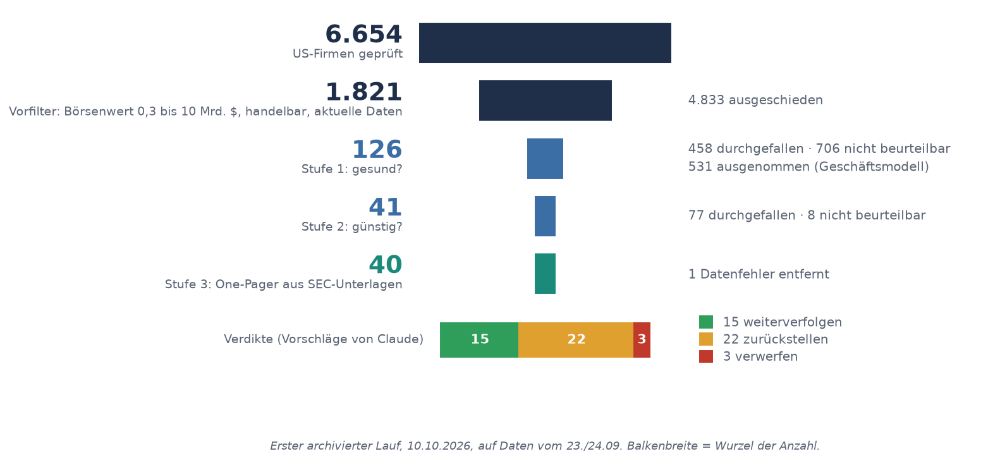
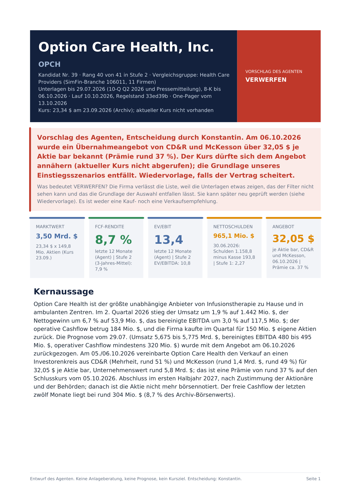

# equity-research-pipeline

Ein Filter, der aus 6.654 US-Aktien 40 macht, die sich zu lesen lohnen. Zu jeder schreibt ein KI-Agent aus den SEC-Originalunterlagen einen One-Pager. Die Entscheidung trifft ein Mensch.

[English](README.md)



## Worum es geht

Beim Investieren stoße ich vor allem an eine Grenze: Zeit. Tausende Geschäftsberichte kann niemand lesen. Deshalb habe ich ein eigenes Konzept entwickelt und umgesetzt. Ein Filtersystem prüft börsennotierte US-Unternehmen systematisch auf finanzielle Gesundheit und auf eine im Branchenvergleich günstige Bewertung. Was übrig bleibt, liest ein KI-Agent in den Originalunterlagen und fasst es zusammen. Am Ende entscheidet ein Mensch. Das System kauft nichts selbst. Es ist keine Renditemaschine, es spart die knappste Ressource: Zeit.

Ob die Auswahl etwas taugt, soll ein Archiv zeigen. Die Messlatte dafür stand vor dem ersten archivierten Lauf fest. Gebaut seit dem 14.09.2026.

## Meine Rolle

Idee und Konzept sind von mir. Den Filter habe ich über Recherche aufgebaut, die Belege zu jeder Regel stehen in [`docs/evidenz_filter.md`](docs/evidenz_filter.md). Programmiert habe ich nicht selbst. Code, Tests und die Entwürfe der One-Pager hat Claude Code geschrieben: Über 90 % der Commits (ohne Merges) tragen eine Co-Author-Zeile von Claude. Commits mit dem Autor „Claude (VPS)“ kommen vom Agenten auf einem Server.

Entschieden habe ich. Der Agent arbeitet in eigenen Branches, und bis auf zwei frühe Commits kam jede Änderung als Pull Request. Alle Pull Requests habe ich selbst gemergt. Die übrigen Merges in der Historie sind Abgleiche des Agenten in seinen eigenen Branches. Als zusätzliche Hürde ist `gh pr merge` für ihn in [`.claude/settings.json`](.claude/settings.json) gesperrt. Beispiele für meine Entscheidungen, mit Datum in [`docs/decisions.md`](docs/decisions.md):

- Die Messlatte: S&P 500 für die Auswahl, MSCI World für die Euro-Sicht, gewöhnliche thesaurierende ETFs, dazu ein Vergleichskorb aus den zehn besten Firmen nach mechanischem Rang (08.10.2026).
- Eine eigene Marke für Margen am Gipfel. Ein niedriges EV/EBITDA bei Rekordmarge ist die klassische Falle eines solchen Filters (07.10.2026).
- Eine verdächtige Aktienzahl schließt eine Firma aus, ohne Ausnahmeliste (07.10.2026).
- Zwölf-Monats-Zahlen dürfen ein Verdikt nur senken, nie heben (15.10.2026).

**Kontrolle:** Arbeitspakete prüft ein frischer Prüflauf ohne Vorwissen. Bei VNT fand er 305 Mio. $ kurzfristige Kredite, die in den Nettoschulden fehlten. Änderungen haben drei Risikoklassen mit Stoppregeln ([`docs/arbeitsweise.md`](docs/arbeitsweise.md)), und ein Hook blockiert riskante Shell-Befehle ([`docs/bash-guard.md`](docs/bash-guard.md)).

## Ergebnisse

Erster archivierter Lauf vom 10.10.2026, Kurse vom 23.09.2026.

| Schritt | Firmen | Ausgeschieden |
|---|---:|---|
| US-Börsenfirmen (SimFin) | 6.654 | |
| Vorfilter: Börsenwert 0,3 bis 10 Mrd. $, handelbar, aktuelle Daten | 1.821 | 4.833 |
| Stufe 1: finanzielle Gesundheit | 126 | 458 durchgefallen, 706 nicht beurteilbar, 531 Geschäftsmodell ausgenommen |
| Stufe 2: Bewertung im Branchenvergleich | 41 | 77 durchgefallen, 8 nicht beurteilbar |
| Kandidatenliste | 40 | XPER, Datenfehler beim Anbieter |

Mehr als die Hälfte der 1.290 Firmen, für die der Filter gilt, fällt in Stufe 1 wegen Datenlücken heraus, nicht wegen schwacher Zahlen. Eine fehlende Zahl wird nicht still auf null gesetzt, die Firma gilt dann als nicht beurteilbar.

Für alle 40 gibt es einen One-Pager ([Liste mit Kennzahlen](docs/kandidaten/runde1.md)). Die Verdikte des Agenten: 15 weiterverfolgen, 22 zurückstellen, 3 verwerfen. Das sind Vorschläge, keine Kaufempfehlungen.

[](docs/onepager/OPCH.pdf)

Beispiel OPCH als [PDF](docs/onepager/OPCH.pdf). Seite 1 ist der One-Pager, die Seiten danach sind Belege.

Am interessantesten sind die Fälle, in denen die Unterlagen etwas anderes zeigten als der Filter:

- **OPCH** bestand beide Stufen. Eine 8-K vom 06.10.2026 meldet ein Übernahmeangebot über 32,05 $ je Aktie in bar, der Lauf rechnete noch mit 23,34 $. Damit fehlt die Grundlage der Auswahl. Verdikt: verwerfen.
- **TNC:** Stufe 2 sieht 8,3 % freie Cashflow-Rendite im Dreijahresmittel. In den letzten zwölf Monaten war der freie Cashflow negativ (−0,2 %). Die Trend-Prüfung hatte die Firma markiert. Verdikt: verwerfen.
- **Zukäufe:** Bei 7 von 25 Firmen der zweiten und dritten Bearbeitungsrunde kam nach dem Geschäftsjahr ein großer Zukauf dazu (KFY, INGR, ESAB, PNR, VCTR, MTDR, ALG). Schulden und Ergebnis im Filter sind dann veraltet. Alle 7 stehen auf „zurückstellen“.
- **XPER** stand nach Stufe 2 auf Platz 4. Der Datenanbieter hatte unter einer ID die Fundamentaldaten von Adeia mit dem Kurs von Xperi vermischt. Erkannt und von der Liste genommen.

Weitere Befunde wie Einmaleffekte und Mietverpflichtungen stehen in den Übersichten zu [Runde A](docs/onepager/uebersicht_tranche_a.md) sowie [Runde B und C](docs/onepager/uebersicht_tranche_bc.md). Sie ändern noch keine Schwelle.

## Ablauf

| Stufe | Was geprüft wird | Startwerte, meist mit Grauzone |
|---|---|---|
| Vorfilter | Größe, Handel, Aktualität der Daten | Börsenwert 0,3 bis 10 Mrd. $ |
| 1 Gesundheit | Kapitalrendite, Cash Conversion und Marge im Dreijahresmittel, Verschuldung zum Stichtag | ROIC über 12 %, Net Debt/EBITDA unter 2,3, Cash Conversion ab 1,0, Nettomarge ab 2 % |
| 2 Bewertung | günstig gegenüber der eigenen Branche | EV/EBITDA im günstigsten Drittel, freie Cashflow-Rendite über 6 % |
| Trend-Prüfung | sinkender Umsatz, sinkende Marge, Marge am Gipfel | nur Marke, kein Ausschluss |
| 3 Unterlagen | Agent liest 10-K, 10-Q und 8-K nach fester [Vorlage](docs/stufe3/one_pager_vorlage.md) und [Checkliste](docs/stufe3/checkliste.md) | Kernthese, Risiken, Kill-Kriterium, Verdikt-Vorschlag |
| 4 Entscheidung | ein Mensch | außerhalb des Codes |

Vorfilter, Stufe 1, Stufe 2 und Trend-Prüfung sind getesteter Code, die Schwellen stehen in [`config/`](config/). Das Kill-Kriterium ist die Zahl, bei der die These erledigt ist.

## Aufbau

Python mit SQLite. Der Code in [`src/`](src/) ist in Schichten geteilt: Daten laden und zwischenspeichern (`data_layer`), Kennzahlen rechnen (`metrics_layer`), Prüfungen anwenden (`gates_layer`), Schwellen lesen (`config_layer`) und jeden Lauf archivieren (`store_layer`). Die Skripte `run_*.py` im Hauptordner führen die Stufen aus. `render_onepager_pdf.py` macht aus einem One-Pager in YAML ein PDF.

## Designentscheidungen

| Entscheidung | Warum | Nachlesen |
|---|---|---|
| Eine fehlende Zahl macht die Kennzahl ungültig, der Grund steht im Ergebnis. Einzige Ausnahme: Eine fehlende Schuldenposition zählt als 0, mit Marke. | Eine still gesetzte Null sieht aus wie ein echter Wert. | [`docs/decisions.md`](docs/decisions.md) |
| Grauzone statt harter Grenze: bestanden, bestanden mit Marke, durchgefallen. | Ein Wert knapp unter der Schwelle macht noch keine schlechte Firma. | [`config/thresholds.yaml`](config/thresholds.yaml) |
| Rang nach Zahl der Marken, kein Gesamtscore. | Ein Score täuscht eine Genauigkeit vor, die die Daten nicht hergeben. | [`docs/decisions.md`](docs/decisions.md) |
| Jeder Lauf bleibt im Archiv: alle Firmen, Stufe des Ausscheidens, Regelstand als Git-Commit, Kurs. | Nur so lässt sich später ehrlich messen. | [`src/store_layer/`](src/store_layer/) |
| Regeln gegen die Forschung gehalten. | Rentabilität und ein niedriges Enterprise Multiple sind belegt (Novy-Marx 2013; Loughran und Wellman 2011). Die konkreten Schwellen sind Startwerte. | [`docs/evidenz_filter.md`](docs/evidenz_filter.md) |

Die Historie dieses Repos ist eine bereinigte Fassung des privaten Arbeitsrepos. Commit-Kennungen, die in den Dokumenten genannt werden (etwa der Regelstand `33ed39b`), findest du über [`docs/commit_zuordnung.md`](docs/commit_zuordnung.md).

## Messlatte

Festgelegt am 08.10.2026, zwei Tage vor dem ersten archivierten Lauf. Drei Fragen, getrennt gemessen ([`config/benchmarks.yaml`](config/benchmarks.yaml)):

| Frage | Vergleich |
|---|---|
| Taugt die Auswahl? | Käufe gegen den S&P 500 (iShares Core S&P 500, thesaurierend), in Dollar |
| Bringen Stufe 3 und 4 etwas? | gekaufte gegen nicht gekaufte Firmen derselben Liste, dazu ein gleich gewichteter Korb der zehn besten Firmen nach mechanischem Rang |
| Lohnt es sich gegenüber einem Welt-ETF? | Euro-Rendite gegen den MSCI World (Xtrackers MSCI World 1C), Währungseffekt in eigener Zeile |

Zeitraum 24 Monate, Zwischenbericht nach 12. Vergleiche, die auf One-Pagern beruhen, starten am Datum des One-Pagers, nicht am Kursdatum. Das Abbruchkriterium hängt nur an der ersten Frage. Seine Zählregel wird erst nach Runde 1 festgelegt und gilt deshalb ab Runde 2.

Was die Messlatte nicht kann: Bei 10 bis 15 Positionen zeigt sie nach 24 Monaten nur grobes Versagen, keinen kleinen Vorsprung. Außerdem enthält der S&P 500 Großkonzerne, die Auswahl kleinere Firmen. Ein Abstand kann also auch an der Größe liegen.

## Grenzen

- Noch keine Erfolgsbilanz.
- Wer durchkommt, hat eher einfache Bilanzen und saubere Daten.
- Der Filter rechnet mit Geschäftsjahreszahlen. Zukäufe danach und Einbrüche in den letzten zwölf Monaten sieht er nicht, das fängt bisher erst Stufe 3 ab.
- Stufe 3 ist noch kein Code. Der Agent hat die One-Pager nach Vorlage geschrieben und die Zwölf-Monats-Zahlen selbst gerechnet. Die Prompts für Bull, Bear und Synthese in [`docs/stufe3/prompts/`](docs/stufe3/prompts/) sind noch nicht erprobt, die One-Pager entstanden ohne sie.
- Gegen die SEC-Originale geprüft sind bisher 2 von 40 One-Pagern (OPCH und TNC, 307 prüfbare Aussagen, 4 Rundungsfehler korrigiert).
- Kurse vom 23.09.2026. Bei 11 von 40 One-Pagern stammen Unterlagen von später.
- Banken, Versicherer, REITs und Biotech sind ausgenommen. Das betrifft 531 der 1.821 Firmen nach dem Vorfilter.

## Wie es weitergeht

1. **Stufe 3 in Code:** Zwölf-Monats-Zahlen aus dem Code statt vom Agenten. Reißen sie eine harte Grenze, gibt es eine Marke, und das Verdikt ist höchstens „zurückstellen“. Danach eine Agentenarena: getrennte Bull- und Bear-Thesen, dann eine Synthese.
2. **Weitere Branchen:** erst Datenlücken schließen, dann je ein Modul für Banken, REITs und Versicherer mit 3 bis 5 eigenen Kennzahlen. Neue Branchen laufen über Profile in [`config/sector_profiles.yaml`](config/sector_profiles.yaml), nicht über Sonderfälle im Code.
3. **Weitere Märkte:** später. Die Datenschicht ist austauschbar gebaut, aber gute Auslandsdaten kosten Geld.

Die Datenkosten bleiben bei null, bis eine Messung zeigt, dass ein bezahlter Tarif ein konkretes Problem löst.

## Selbst ausprobieren

Python 3, SQLite, pytest. Daten: SimFin (kostenloser Tarif), SEC EDGAR, Alpha Vantage für die ETF-Kurse. Gebaut mit Claude Code.

```
pip install -r requirements.txt
python -m pytest
```

Auf einem frischen Klon laufen rund 2.500 Tests grün, 0 schlagen fehl. Gut 220 werden übersprungen, unter Windows einige mehr (Symlinks, Shell-Hook). Die übersprungenen brauchen meist SimFin-Rohdaten, deren Lizenz keine Weitergabe erlaubt. Den Filter selbst neu laufen zu lassen geht deshalb nur mit eigenem SimFin-Schlüssel.

One-Pager als PDF erzeugen: `python render_onepager_pdf.py docs/onepager/OPCH.yaml --out OPCH.pdf`. Ohne SimFin-Daten fehlt darin der Peer-Vergleich.

Gute Einstiege: die [Kandidatenliste](docs/kandidaten/runde1.md), die [Befunde aus Runde B und C](docs/onepager/uebersicht_tranche_bc.md) und die [Arbeitsweise mit dem Agenten](docs/arbeitsweise.md). Das vollständige Protokoll aller Regeln ist [`docs/decisions.md`](docs/decisions.md), datiert und sehr lang.

## Hinweis und Lizenz

Keine Anlageberatung, ein Forschungs- und Lernprojekt. Die One-Pager nennen einige aus SimFin-Daten abgeleitete Zahlen (Vergleichsgruppen, Ränge, Archivkurse), SEC-Unterlagen sind öffentlich. Die Dokumentation ist auf Deutsch. MIT, siehe [LICENSE](LICENSE).
