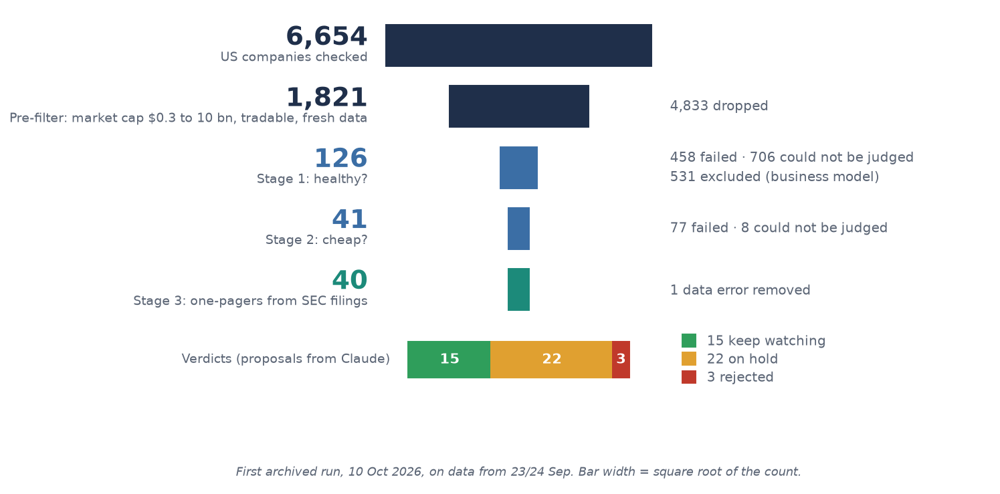

# equity-research-pipeline

A filter that turns 6,654 US stocks into 40 worth reading. For each one, an AI agent writes a one-pager from the original SEC filings. A human makes the decision.

[Deutsch](README.de.md)



## What this is

When investing, the limit I hit most is time. Nobody can read thousands of annual reports. So I designed and built my own approach. A filter systematically checks listed US companies for financial health and for a valuation that is cheap relative to their industry. An AI agent reads the original filings of what is left and summarizes them. A human decides at the end. The system never buys anything on its own. It is not a return machine; it saves the scarcest resource: time.

An archive is meant to show whether the selection is any good. The benchmark for that was fixed before the first archived run. Built since 14 September 2026.

## My role

The idea and the concept are mine. I built the filter through research; the evidence behind each rule is in [`docs/evidenz_filter.md`](docs/evidenz_filter.md). I did not write the code myself. Code, tests and one-pager drafts were written by Claude Code: over 90% of commits (excluding merges) carry a Claude co-author line. Commits authored by "Claude (VPS)" come from the agent running on a server.

The decisions were mine. The agent works on its own branches, and apart from two early commits every change came in as a pull request. I merged every pull request myself. The other merges in the history are the agent syncing its own branches. As an extra hurdle, `gh pr merge` is blocked for it in [`.claude/settings.json`](.claude/settings.json). Examples of my decisions, dated in [`docs/decisions.md`](docs/decisions.md):

- The benchmark: S&P 500 for the selection, MSCI World for the euro view, plain accumulating ETFs, plus a comparison basket of the ten best companies by mechanical rank (8 Oct 2026).
- A separate flag for peak margins. A low EV/EBITDA at a record margin is the classic trap of a screen like this (7 Oct 2026).
- A suspicious share count excludes a company, with no override list (7 Oct 2026).
- Trailing-twelve-month figures may only lower a verdict, never raise it (15 Oct 2026).

**Controls:** work packages are checked by a fresh review run with no prior context. For VNT it found USD 305 m of short-term borrowings missing from net debt. Changes fall into three risk classes with stop rules ([`docs/arbeitsweise.md`](docs/arbeitsweise.md)), and a hook blocks risky shell commands ([`docs/bash-guard.md`](docs/bash-guard.md)).

## Results

First archived run on 10 Oct 2026, prices as of 23 Sep 2026.

| Step | Companies | Dropped |
|---|---:|---|
| US-listed companies (SimFin) | 6,654 | |
| Pre-filter: market cap USD 0.3–10 bn, tradable, current data | 1,821 | 4,833 |
| Stage 1: financial health | 126 | 458 failed, 706 not assessable, 531 business model excluded |
| Stage 2: valuation vs. industry | 41 | 77 failed, 8 not assessable |
| Candidate list | 40 | XPER, data error at the provider |

More than half of the 1,290 companies the filter applies to drop out in stage 1 because of missing data, not weak numbers. A missing value is never silently set to zero; the company is marked as not assessable instead.

All 40 have a one-pager ([list with metrics](docs/kandidaten/runde1.md)). The agent's verdicts: 15 follow up, 22 defer, 3 discard. These are suggestions, not buy recommendations.

[](docs/onepager/OPCH.pdf)

Example: OPCH as a [PDF](docs/onepager/OPCH.pdf). Page 1 is the one-pager; the following pages are supporting evidence.

The most interesting cases are those where the filings showed something the filter could not see:

- **OPCH** passed both stages. An 8-K dated 6 Oct 2026 reports a USD 32.05 per share cash takeover offer; the run still used USD 23.34. That removes the basis for the selection. Verdict: discard.
- **TNC:** stage 2 sees an 8.3% free cash flow yield (three-year average). Over the last twelve months free cash flow was negative (−0.2%). The trend check had flagged the company. Verdict: discard.
- **Acquisitions:** for 7 of 25 companies in the second and third batch, a large acquisition came after the fiscal year (KFY, INGR, ESAB, PNR, VCTR, MTDR, ALG). Debt and earnings in the filter are then out of date. All 7 are on "defer".
- **XPER** ranked 4th after stage 2. The data provider had mixed Adeia's fundamentals with Xperi's share price under one ID. Caught and removed from the list.

Further findings such as one-off items and lease obligations are in the summaries for [batch A](docs/onepager/uebersicht_tranche_a.md) and [batches B and C](docs/onepager/uebersicht_tranche_bc.md) (German). They have not changed any threshold yet.

## Pipeline

| Stage | What is checked | Starting values, mostly with a grey zone |
|---|---|---|
| Pre-filter | size, trading, data freshness | market cap USD 0.3–10 bn |
| 1 Health | return on capital, cash conversion and margin as three-year averages, leverage at the balance sheet date | ROIC above 12%, net debt/EBITDA below 2.3, cash conversion from 1.0, net margin from 2% |
| 2 Valuation | cheap relative to its own industry | EV/EBITDA in the cheapest third, free cash flow yield above 6% |
| Trend check | falling revenue, falling margin, peak margin | flag only, no exclusion |
| 3 Filings | agent reads 10-K, 10-Q and 8-K using a fixed [template](docs/stufe3/one_pager_vorlage.md) and [checklist](docs/stufe3/checkliste.md) | thesis, risks, kill criterion, suggested verdict |
| 4 Decision | a human | outside the code |

The pre-filter, stages 1 and 2 and the trend check are tested code; thresholds live in [`config/`](config/). The kill criterion is the number at which the thesis is dead.

## Architecture

Python with SQLite. The code in [`src/`](src/) is split into layers: loading and caching data (`data_layer`), computing metrics (`metrics_layer`), applying the checks (`gates_layer`), reading thresholds (`config_layer`) and archiving every run (`store_layer`). The `run_*.py` scripts in the root run the stages. `render_onepager_pdf.py` turns a one-pager in YAML into a PDF.

## Design decisions

| Decision | Why | Details |
|---|---|---|
| A missing value makes the metric invalid, and the reason is recorded. Only exception: a missing debt item counts as 0, with a flag. | A silent zero looks like a real value. | [`docs/decisions.md`](docs/decisions.md) |
| Grey zone instead of a hard cut-off: pass, pass with flag, fail. | A value just below a threshold does not make a bad company. | [`config/thresholds.yaml`](config/thresholds.yaml) |
| Rank by number of flags, no composite score. | A score suggests a precision the data cannot support. | [`docs/decisions.md`](docs/decisions.md) |
| Every run is archived: all companies, the stage where they dropped out, the rule version as a Git commit, the price. | The only way to measure honestly later. | [`src/store_layer/`](src/store_layer/) |
| Rules checked against research. | Profitability and a low enterprise multiple are well documented (Novy-Marx 2013; Loughran and Wellman 2011). The specific thresholds are starting values. | [`docs/evidenz_filter.md`](docs/evidenz_filter.md) |

This repository's history is a cleaned copy of the private working repository. Commit IDs mentioned in the documents (such as rule version `33ed39b`) can be looked up in [`docs/commit_zuordnung.md`](docs/commit_zuordnung.md).

## Benchmark

Fixed on 8 Oct 2026, two days before the first archived run. Three questions, measured separately ([`config/benchmarks.yaml`](config/benchmarks.yaml)):

| Question | Comparison |
|---|---|
| Is the selection any good? | purchases vs. the S&P 500 (iShares Core S&P 500, accumulating), in US dollars |
| Do stages 3 and 4 add anything? | bought vs. not-bought companies from the same list, plus an equal-weighted basket of the ten best companies by mechanical rank |
| Is it worth it compared with a world ETF? | euro return vs. the MSCI World (Xtrackers MSCI World 1C), currency effect shown separately |

Horizon 24 months, interim report after 12. Comparisons based on one-pagers start on the one-pager date, not the price date. The stop criterion depends only on the first question. Its counting rule will only be set after round 1 and therefore applies from round 2.

What the benchmark cannot do: with 10 to 15 positions, after 24 months it only reveals gross failure, not a small edge. Also, the S&P 500 holds large caps while the selection holds smaller companies, so any gap may simply reflect size.

## Limitations

- No track record yet.
- What gets through tends to have simple balance sheets and clean data.
- The filter uses fiscal-year figures. It does not see later acquisitions or a slump in the last twelve months; for now only stage 3 catches those.
- Stage 3 is not code yet. The agent wrote the one-pagers from the template and computed the trailing-twelve-month figures itself. The bull, bear and synthesis prompts in [`docs/stufe3/prompts/`](docs/stufe3/prompts/) have not been tried yet; the one-pagers were written without them.
- So far 2 of 40 one-pagers have been checked against the SEC originals (OPCH and TNC: 307 verifiable statements, 4 rounding errors fixed).
- Prices as of 23 Sep 2026. For 11 of 40 one-pagers, some filings are from later.
- Banks, insurers, REITs and biotech are excluded. That affects 531 of the 1,821 companies after the pre-filter.

## Next steps

1. **Stage 3 in code:** trailing-twelve-month figures computed by code instead of the agent. If they breach a hard limit, the company gets a flag and the verdict is at most "defer". Then an agent arena: separate bull and bear theses, followed by a synthesis.
2. **More industries:** first close data gaps, then one module each for banks, REITs and insurers with 3 to 5 metrics of their own. New industries are added through profiles in [`config/sector_profiles.yaml`](config/sector_profiles.yaml), not special cases in the code.
3. **More markets:** later. The data layer is swappable, but good non-US data costs money.

Data costs stay at zero until a measurement shows that a paid plan solves a specific problem.

## Try it

Python 3, SQLite, pytest. Data: SimFin (free plan), SEC EDGAR, Alpha Vantage for the ETF prices. Built with Claude Code.

```
pip install -r requirements.txt
python -m pytest
```

On a fresh clone about 2,500 tests pass and none fail. Just over 220 are skipped, a few more on Windows (symlinks, shell hook). Most skipped tests need SimFin raw data, whose licence does not allow redistribution, so re-running the filter itself requires your own SimFin key.

Render a one-pager as PDF: `python render_onepager_pdf.py docs/onepager/OPCH.yaml --out OPCH.pdf`. Without SimFin data the peer comparison is omitted.

Good places to start: the [candidate list](docs/kandidaten/runde1.md), the [findings from batches B and C](docs/onepager/uebersicht_tranche_bc.md) and the [way of working with the agent](docs/arbeitsweise.md). The full log of every rule is [`docs/decisions.md`](docs/decisions.md), dated and very long.

## Disclaimer and licence

Not investment advice; a research and learning project. The one-pagers show some figures derived from SimFin data (peer groups, ranks, archived prices); SEC filings are public. Apart from this README, the documentation is in German. MIT, see [LICENSE](LICENSE).
